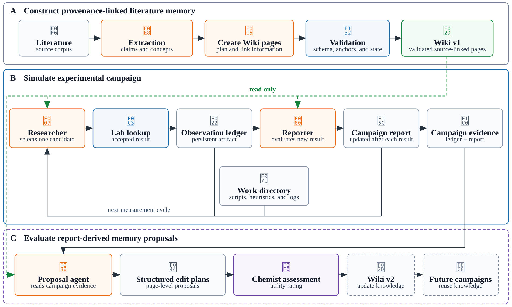

# Organizational Memory for Agent-Guided Peptide Discovery

This repository contains the code for a research system that tests whether structured literature memory can help language-model agents make better experimental decisions. 
The system extracts source-grounded concepts from scientific PDFs, compiles them into 
a validated Markdown Wiki, and gives an experimental agent read-only access during 
closed-loop campaigns. A matched no-Wiki condition uses the same campaign setup 
without access to the literature memory.


The repository contains the complete knowledge-construction pipeline, the simulated
laboratory, persistent campaign orchestration, comparison baselines, evaluation
scripts, and architecture documentation used by the project.

## About the paper

This repository accompanies the NeurIPS 2026 ML4Molecules workshop paper
*Organizational Memory for Agent-Guided Peptide Discovery*. The paper asks whether
read-only access to a frozen, provenance-linked literature Wiki improves finite-budget
discovery. We construct the Wiki from 34 papers and compare otherwise identical Wiki
and no-Wiki agents as they select from 409 measured peptide-amphiphile sequence–pH
candidates.



*System overview. (A) Scientific literature is converted into a provenance-linked,
validated Wiki. (B) Wiki-backed and no-Wiki researchers use the same controlled
campaign workflow. The Wiki is read-only, and all measurements enter a persistent
evidence ledger. (C) Campaign reports can produce structured proposals for later
Wiki revisions. The revised Wiki and subsequent campaigns are outside the current
evaluation scope.*

## System design

The repository separates probabilistic scientific judgment from deterministic control:

- **Evidence-grounded memory.** Extracted claims retain PDF page anchors and paper
  provenance. A critic and repair loop improves proposals before publication.
- **Corpus-level synthesis.** Typed agents decide which candidates to retain, resolve
  semantic `MERGE` and `LINK` relations, and define coherent pages. Sparse similarity
  graphs and PageRank prioritize work and links.
  truth.
- **Independent validation.** Python code checks schemas, evidence anchors,
  provenance, frontmatter, link targets, graph boundaries, and edit scope. A model
  cannot waive a deterministic finding.
- **Controlled experimentation.** The researcher selects experiments, a mediated lab
  capability enforces the catalog and budget, and a separate read-only curator
  evaluates each result and maintains the campaign report.
- **Recoverable execution.** Content-addressed checkpoints, per-paper commits,
  proposal snapshots, and append-only observations make long runs inspectable and
  resumable.
- **Bounded agents.** Shell-enabled roles run as unprivileged users in disposable,
  network-isolated Docker sandboxes. Host orchestration retains authority over the
  repository, laboratory, budgets, and publication.

## Requirements

- Python 3.12 or later
- [`uv`](https://docs.astral.sh/uv/)
- Docker with an accessible daemon
- A model endpoint supported by the OpenAI Agents SDK
- An OpenAI-compatible embeddings endpoint

Install the locked environment and create a local configuration file:

```bash
uv sync
cp .env.example .env
```

At minimum, set `OPENAI_API_KEY` and the embedding endpoint settings in `.env`.
The supplied example documents all model, concurrency, graph-ranking, storage, and
logging options. By default, vector indexes are stored locally in Qdrant under the
target Wiki repository. Set `QDRANT_URL` instead of `QDRANT_PATH` to use a Qdrant
service. The two settings are mutually exclusive.

## Build a literature Wiki

Place source PDFs in a repository-local `sources/` directory and run the complete
pipeline:

```bash
mkdir -p /path/to/wiki-repository/sources
cp /path/to/papers/*.pdf /path/to/wiki-repository/sources/
uv run wiki-agent /path/to/wiki-repository --progress
```

The first run initializes the target as a Git repository on `main`. Source PDFs and
derived vector data remain local and ignored by Git. Accepted extraction snapshots,
paper references, and the final Wiki are versioned. Each completed paper is committed
independently. The validated Wiki graph is published as one atomic commit.

Use an external source directory when PDFs should remain outside the Wiki repository:

```bash
uv run wiki-agent /path/to/wiki-repository \
  --sources-path /path/to/papers \
  --progress
```

The three persistent stages can also run independently. This is useful for inspecting
intermediate artifacts or resuming an interrupted run:

```bash
uv run extract-concepts /path/to/wiki-repository --sources-path /path/to/papers
uv run create-plans /path/to/wiki-repository
uv run write-wiki /path/to/wiki-repository
```

The `--progress` flag shows live progress and logs. The scripts will not return intermediary progress if this flag is omitted.

### Persistent Wiki artifacts

| Path | Contents |
| --- | --- |
| `extractions/*.json` | Accepted, source-grounded concept snapshots. These snapshots are the source of truth for derived vector state. |
| `wiki/references/papers/` | OKF paper references and local links to source artifacts. |
| `wiki/` | Validated concept pages and corpus metadata. |
| `.checkpoints/concepts/` | Extraction state keyed by source content and pipeline configuration. |
| `.checkpoints/wiki/` | Corpus plans, page attempts, and proposals keyed by corpus and generation configuration. |
| `.qdrant/` | Rebuildable local similarity indexes. |
| `.staging/` | Temporary publication transactions that are cleaned after publication. |

Checkpoint keys include content and configuration fingerprints. A run reuses only
compatible completed work. Failed page attempts preserve their latest reviewed
proposal and findings for a later retry.

## Run a controlled experimental campaign

The included CSV-backed laboratory exposes peptide sequence and pH as inputs and
returns concentration and surface tension. Start it in one terminal:

```bash
uv run start-lab data/dataset.csv
```

Then start or resume a Wiki-backed campaign in another terminal:

```bash
uv run run-experimentalist \
  /path/to/wiki-repository/wiki \
  /path/to/campaign \
  --task "Find peptide and pH combinations that minimize surface tension."
```

Use `--task-file objective.md` for a longer objective. The default lab URL is
`http://127.0.0.1:8000`. Override it with `--lab-url` or `LAB_API_URL`. The campaign
defaults to a 100-request budget, batches of one, and 30 researcher turns. Use
`--request-budget`, `--batch-size`, and `--researcher-turns` to change these limits.

To run the matched condition without literature memory:

```bash
uv run python scripts/no_wiki_experimentalist.py \
  /path/to/campaign-without-wiki \
  --task "Find peptide and pH combinations that minimize surface tension."
```

Both conditions use the same planning, research, curation, budget, sandbox, and lab
interfaces. The controlled difference is read-only Wiki access.

### Persistent campaign artifacts

| Path | Contents |
| --- | --- |
| `campaign.json` | Immutable task, measurement contract, strategy, budget, and lifecycle state. |
| `requests.json` | Accepted measurement requests and their rationales. |
| `observations.jsonl` | Authoritative append-only evidence ledger. |
| `report.md` | Rolling synthesis, hypothesis status, and recommended priorities. |
| `sessions/` | Visible researcher transcripts. |
| `work/` | Persistent researcher analyses and intermediate artifacts. |

Only the host-side lab capability can accept a measurement request. It rejects
unknown, duplicate, malformed, oversized, and over-budget requests before recording
the returned observation. A campaign stops when its budget or experiment catalog is
exhausted.

## Evaluation utilities

The `scripts/` directory contains the campaign ablation and analysis utilities:

| Script | Purpose |
| --- | --- |
| `no_wiki_experimentalist.py` | Run the no-Wiki campaign condition. |
| `random_sampling.py` | Generate a seeded uniform-sampling baseline ledger. |
| `active_learning.py` | Generate a seeded Gaussian-process expected-improvement baseline ledger. |
| `calculate_hits.py` | Report hit counts and the best observed conditions at a threshold. |
| `plot_observations.py` | Plot campaign observations. |
| `suggest_wiki_edits.py` | Convert campaign evidence into structured, report-grounded Wiki edit proposals. |

For example, generate a reproducible random baseline and score it:

```bash
uv run python scripts/random_sampling.py \
  data/dataset.csv /tmp/random-observations.jsonl \
  --budget 100 --seed 0

uv run python scripts/calculate_hits.py \
  /tmp/random-observations.jsonl 30.0
```

Run every stochastic baseline with explicit seeds, keep each campaign directory, and
record the resolved `.env` configuration and source commit with reported results.

## Configuration

`.env.example` is the canonical configuration reference. Frequently changed settings
include:

| Setting | Role | Default |
| --- | --- | ---: |
| `WIKI_NUM_CONCEPT_PAGES` | PDF pages per extraction chunk | `3` |
| `WIKI_EXTRACTION_WORKERS` | Concurrent extraction chunks | `4` |
| `WIKI_PLANNING_BATCH_SIZE` | Candidate plans per request | `5` |
| `WIKI_WORK_PACKAGE_TOP_K` | Similarity neighbors considered for relation work | `20` |
| `WIKI_MAX_OUTGOING_LINKS` | Normal outgoing-link limit per page | `8` |
| `WIKI_PAGE_WORKERS` | Concurrent page jobs | `4` |
| `WIKI_MAX_TURNS` | Correction runs after initial page creation | `5` |
| `WIKI_PAGE_TRANSIENT_RETRIES` | Infrastructure retries per page operation | `2` |
| `WIKI_FINALIZER_BATCH_SIZE` | Pages per corpus-finalization package | `20` |

The semantic, personalized-PageRank, and global-PageRank link weights must sum to `1.0`.

## Repository layout

```text
src/wiki_agents/   Core agents, orchestration, validation, storage, and lab server
tests/             Unit, integration, resilience, and workflow tests
scripts/           Baselines, analysis, ablation, plotting, and edit proposals
data/              Simulated-lab datasets and evaluation data
docs/              Architecture and workflow documentation
figures/           Paper figures and generated analysis plots
```

## Development and verification

Run the test suite:

```bash
uv run pytest
```

Run the repository's required static checks:

```bash
uvx ty check
uv run ruff check .
```

## Citation

This repository accompanies the NeurIPS 2026 ML4Molecules workshop paper "Organizational Memory for Agent-Guided Peptide Discovery". If you use this code in your research, please cite the paper:

```bibtex
@inproceedings{voinea2026organizational,
  title={Organizational Memory for Agent-Guided Peptide Discovery},
  author={Andrei Voinea and Tal Kachman and Mathijs Mabesoone},
  booktitle={NeurIPS 2026 Workshop on Agentic Systems for Molecular Sciences},
  year={2026},
  url={https://openreview.net/forum?id=jPTcdJnmCX}
}
```
